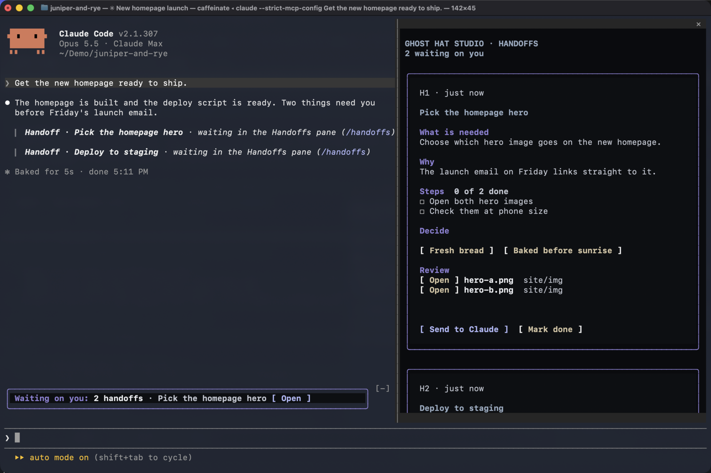
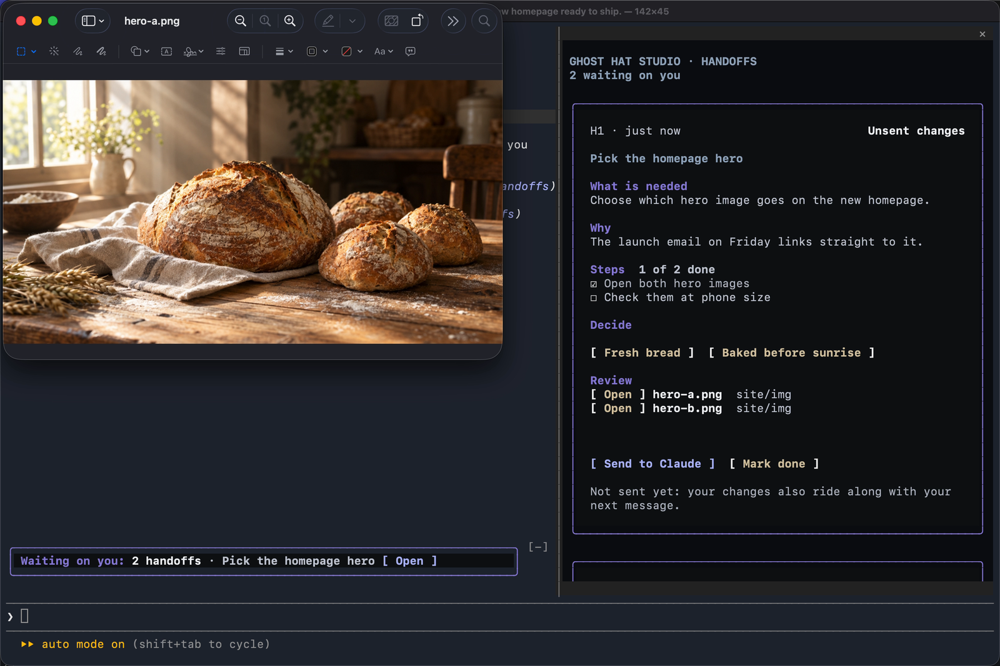

# Handoffs

A mod for Claude Code. When Claude needs you to do or decide something, the request becomes a card in a Handoffs pane, so it doesn't scroll away while you're busy elsewhere.



Watch the [36-second tour on the Toolbox page](https://ghosthatstudio.com/toolbox/handoffs/).

Each card shows what Claude needs and why, with:

- **Steps** to tick off as you do them
- **Decision buttons** when there's a choice to make
- **Open buttons** for the files and web pages to look at
- **Copy buttons** for commands you need to run yourself

A **Waiting on you** band sits above the prompt while any card is open. When you're done, **Send to Claude** or **Mark done** sends your ticks and your pick back, and Claude carries on. Anything you tick without sending goes along with your next message.

## Install

In Claude Code:

```
/plugin marketplace add ghosthat-studio/marketplace
/plugin install handoffs@ghosthat-studio
```

Then run `/reload-plugins`, or start a new session.

## Compatibility

- Mac
- Linux. Open uses `xdg-open`, and Copy uses `wl-copy`, `xclip` or `xsel`.
- Windows: in WSL, in the Claude Code CLI in PowerShell, and in Claude Desktop
- Claude Code 2.1.299 or later

Handoffs is a mod, so it works in Claude Code only.

## Recommended configuration

- **The latest Claude Code.** Run `claude update` in your terminal, and keep Claude Desktop up to date.
- **Fullscreen mode**, so the pane sits beside the conversation: type `/tui fullscreen` (`/tui default` goes back). Until you do, the top of the pane reminds you.
- **Windows Terminal** on Windows. It's the default terminal on Windows 11.
- **The Auto theme**, so the pane follows your system's light or dark mode: type `/theme` and pick Auto.

## On Windows

Handoffs works in all three ways of running Claude Code on Windows: inside WSL, the CLI in PowerShell, and Claude Desktop.

- **Use Windows Terminal.** If you start Claude Code from a shortcut or a `.cmd` file, have it open Windows Terminal (`wt.exe`).
- **Paste each command into the shell it was written for.** With Claude Code on Windows, a card's commands are written for PowerShell. Inside WSL, they're for your WSL shell. The Run heading on the card names the shell, for example *Run in PowerShell* or *Run in Ubuntu terminal*.
- **In WSL, run Claude Code in a WSL terminal on the PC itself.** Open and Copy reach Windows through WSL's Windows interop, which isn't there when you connect to WSL over SSH.
- **Code and text files open in your editor when Windows knows about it.** Open uses the editor registered as the file type's Edit action and falls back to Notepad. Some editors, VS Code among them, don't register that action, so those files open in Notepad.

## Light and dark mode

The pane follows Claude Code's theme. Pick one with `/theme`:

- **Dark** draws the pane on the Ghost Hat near-black, with light violet headings.
- **Light** uses your terminal's background, with deep violet, steel and brass accents.
- **Auto** follows your system's light or dark setting, and the pane switches within a few seconds when the system does.

The Waiting on you band sits on your terminal's own background, so its text always uses your terminal's text colour. If your terminal is light but the theme is Dark (or the other way round), the pane and Claude Code's own colours won't match your terminal. Set the theme to Auto or to the one that matches.

## Using it

You don't need to do anything to turn it on. The mod teaches Claude a short `handoff` block format, and Claude ends a reply with one whenever it's waiting on you. The block shows in the transcript as a one-line pointer, and the card opens in the pane.

- `/handoffs` opens the pane.
- **Open** on a file opens it for review: documents, images and media in their usual app, and code and other text in a text editor. Nothing on a card is ever run.
- Cards are numbered `h1`, `h2` and so on. Each of your messages tells Claude which cards are still open, so it keeps one card per topic: a new request on a topic updates that topic's card, and a card that a new one replaces gets closed. Separate topics keep separate cards.
- Cards are kept per session. Resume a session and its cards come back. A new session starts with an empty pane.
- Open cards go back into the conversation after a compaction, so Claude doesn't forget what it's waiting on.



## What it runs, stores and sends

### Programs it runs

The mod starts programs only to open files and links, copy commands, match your light or dark mode, and tell which system it's on. Each command is fixed text in the code. A path, link or command from a card is passed as one argument or on standard input, never as part of the command text.

- **Open**, only when you click it:
  - macOS: `open`, `open -t` for text, and `open -R` to show a file in Finder
  - Linux: `xdg-open`
  - Windows and WSL: `explorer.exe`, plus `powershell.exe -NoProfile -NonInteractive` running `Start-Process` for text files (the file type's Edit action, or Notepad) and for showing a file in its folder. The path reaches PowerShell on standard input. In WSL, `wslpath -w` turns the path into a Windows one first.
  - A card's paths come from Claude's reply, so Open never runs a program. Documents, images and media open in their usual app, and code and other text files open in a text editor. App bundles, installers, links and anything unrecognized are shown in their folder instead.
- **Copy**, only when you click it: `pbcopy` on macOS; `wl-copy`, `xclip` or `xsel` on Linux; `powershell.exe -NoProfile -NonInteractive` running `Set-Clipboard` on Windows and WSL. The command goes to the clipboard on standard input and is never run. On macOS, Linux and WSL, a command that would change your shell's folder or environment is copied wrapped in `( … )`, so pasting it into Claude's shared shell doesn't change the rest of your session. PowerShell has no such wrapper, so on Windows the command is copied as written.
- **Light or dark mode**, only when the theme is Auto: once when the pane first draws, then every 4 seconds to notice a change. It runs one of these, which reads a single display setting and nothing else:
  - macOS: `defaults read -g AppleInterfaceStyle`
  - Linux: `gsettings get org.gnome.desktop.interface color-scheme`
  - Windows and WSL: `reg.exe query HKCU\Software\Microsoft\Windows\CurrentVersion\Themes\Personalize /v AppsUseLightTheme`
- **Finding out where it runs:** `uname -sr`, once per session, when the environment doesn't already say Windows or WSL. It tells macOS, Linux and WSL apart.

### What it reads

- Claude Code's theme setting, and on Auto your system's light or dark setting, as above.
- The environment variables `OS`, `WSL_DISTRO_NAME`, `HOME` and `USERPROFILE`, to know the platform, name your WSL distribution on the card, and expand `~` in a file path.
- Claude's replies in the main conversation, to find handoff blocks. Replies from subagents are skipped.
- A file's type and whether it exists, only when you click Open on it.

The mod reads no passwords, keys, tokens or other credentials.

### What it adds to Claude's prompts

- **The handoff format.** Each session's instructions to Claude gain a short section that teaches the `handoff` block: the fields, one card per topic, and how to close a card. On Windows and WSL it adds a note on which shell to write commands for. When a session starts with its own system prompt (`--system-prompt`, a custom agent, or an app built on the Agent SDK), the same section goes along with your first message instead.
- **Your open cards, with each message you send.** Each card's id, title, what it needs, its steps and its decision go along with your message, so Claude updates a topic's card instead of starting a new one. Any ticks or picks you made without sending go along too. Messages from scheduled tasks, other sessions and background notifications get nothing added.
- **Your open cards after a compaction.** The same cards go back into the conversation after the summary, with their files to review, links and commands.
- **What you send from a card.** Send to Claude and Mark done submit one message in your name: the card's id and title, the steps you ticked, the option you picked, and whether it's done.

### Hooks

- `session.start` registers `/handoffs`, brings back a resumed session's cards, and starts the light or dark check.
- `command.run` for `/handoffs` opens the pane.
- `config.set` for the theme lets the change through unaltered, then redraws the pane in the new colours.
- `prompt.compose` adds the handoff format section described above. It changes nothing else in the instructions.
- `prompt.context` adds the same section to your first message, only in sessions where Claude Code composes no system prompt of its own. It changes nothing else in the message.
- `session.append` and `turn.complete` read handoff blocks from Claude's replies. They change nothing in the conversation.
- `prompt.submit` adds your open and changed cards to your message, as described above. It changes nothing else in the message.
- `session.compact` adds your open cards after the summary.
- `ui.render` draws the pane and the Waiting on you band, and in the transcript shows each handoff block as a one-line pointer to its card. The reply Claude sees and keeps is unchanged.

### Storage

Cards are saved in Claude Code's plugin store on your machine, per session, and deleted after 14 days.

### What it sends

The mod makes no network calls and sends nothing to Ghost Hat Studio. What it adds to your messages and to Claude's instructions, listed above, goes to Anthropic with the rest of the conversation, as Claude Code always does. Open hands a path or link to your own apps, and Copy puts a command on your clipboard.

## Troubleshooting

**The buttons on a card don't respond to clicks.**
On Windows, you're probably in the older console window rather than Windows Terminal. See [On Windows](#on-windows). Anywhere else, check that your terminal sends mouse clicks to programs; most do by default.

**The pane covers the conversation instead of sitting beside it.**
Claude Code isn't in fullscreen mode. Type `/tui fullscreen`.

**Claude's replies don't turn into cards, or `/handoffs` isn't there.**
Run `/plugin` and check that handoffs is installed and enabled, then `/reload-plugins` or start a new session. If you started Claude Code with a folder of its own plugins (`--plugin-dir`), check the path: a typo there quietly starts Claude Code without the mod.

**A copied command fails with "The token '&&' is not a valid statement separator".**
That's a bash command pasted into Windows PowerShell. Paste it into the shell the card's Run heading names.

**Open or Copy says it couldn't reach the app or the clipboard.**
On Linux, Open needs `xdg-open`, and Copy needs `wl-copy` (Wayland) or `xclip` or `xsel` (X11). In WSL, run Claude Code in a terminal on the PC, not over SSH. The command is always on the card, so you can still select and copy it by hand.

**The pane's colours don't suit your terminal.**
Set `/theme` to Auto, or to Light or Dark to match your terminal. See [Light and dark mode](#light-and-dark-mode).

## Tests

```
claude plugin test .
```

## License

MIT. See [LICENSE](LICENSE).

Made by [Ghost Hat Studio](https://ghosthatstudio.com/). Questions and bug reports go to [the issues page](https://github.com/ghosthat-studio/handoffs/issues).
